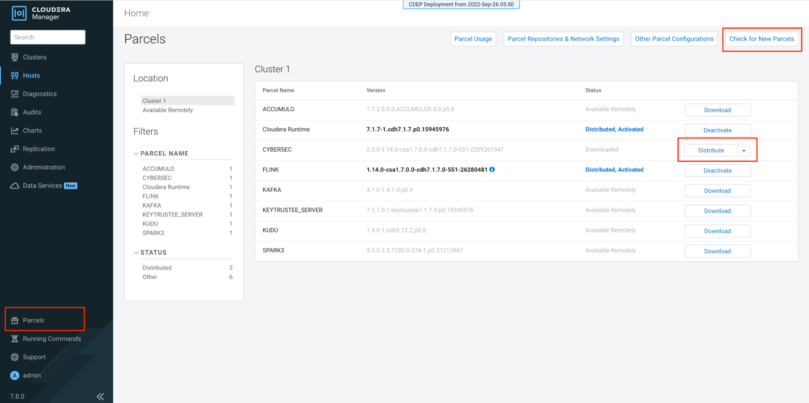

# Installation

## Obtain the Release Parcel
The Cybersec Toolkit includes a Cloudera Manager parcel and service for easier installation.

### Choosing an Official Release (Recommended)

Pick the release that matches your cluster before installing. The
[release selection guide](release_readme.md) maps Cloudera versions and Cloudera Streaming Analytics
versions to the latest release that supports them.

### Building a Development Test Release
See [Building from Source](release_build.md) to build a custom release.

# Stage the Parcel Files on Cloudera Manager host
## Option 1: Host with no access to official github releases
1. Download the release assets from the official release github.  
2. Copy the asserts using ftp or scp to the Cloudera Manager management host. Alternatively set up an additional [Local Package and Parcel Repository](https://docs.cloudera.com/cdp-private-cloud-base/7.3.2/cdp-private-cloud-base-installation/topics/cdpdc-local-package-parcel-repositories.html) to host cybersec toolkit releases.

## Option 2: Host with access to official github releases
1. Log into the Cloudera Manager server via SSH:

```
ssh user@cloudera.manager.host
```

2. If the host has access to github urls, use `wget` to download the required release assets directly to the server:

```
wget https://github.com/cloudera/cybersec/releases/download/<version>/CYBERSEC-2.3.0-1.14.0-csa1.7.0.0-cdh7.1.7.0-551-2209261347-el7.parcel
wget https://github.com/cloudera/cybersec/releases/download/<version>/CYBERSEC-2.3.0-1.14.0-csa1.7.0.0-cdh7.1.7.0-551-2209261347-el7.parcel.sha
wget https://github.com/cloudera/cybersec/releases/download/<version>/CYBERSEC-2.3.0-1.14.0-csa1.7.0.0-cdh7.1.7.0-551-2209261347.jar
```
# Moving the assets to the parcel repo
1. Change the owner of the downloaded parcel files and move them to `/opt/cloudera/parcel-repo/` and `/opt/cloudera/csd/`:

```
chown cloudera-scm:cloudera-scm CYBERSEC*
mv CYBERSEC-2.3.0-1.14.0-csa1.7.0.0-cdh7.1.7.0-551-2209261347-el7.parcel /opt/cloudera/parcel-repo
mv CYBERSEC-2.3.0-1.14.0-csa1.7.0.0-cdh7.1.7.0-551-2209261347-el7.parcel.sha /opt/cloudera/parcel-repo
mv CYBERSEC-2.3.0-1.14.0-csa1.7.0.0-cdh7.1.7.0-551-2209261347.jar /opt/cloudera/csd/
```

2. Restart the Cloudera Manager Server:

```
sudo service cloudera-scm-server restart
```

## Add the Cyber Toolkit Service

1. Open Cloudera Manager. Select **Parcels** from the lower left. Click **Check for New Parcels** on the upper right. Locate the `CYBERSEC` parcel in the list of parcels. Click **Distribute**.

2. After the Distribution completes, click **Activate**.
3. Click **OK** on the "Are you sure?" confirmation dialog.
4. Verify that the `CYBERSEC` parcel status is **Distributed, Activated**.
5.Select the cluster where Flink and YARN are installed. Right-click on the `...` menu and select **Add Service**.
6.Select **Cybersec** and click **Continue**.
7.Assign **Parser Chaining** to one node (hosts the parser UI service) and assign the **Cybersec Gateway** role to all Flink gateway hosts. Click **Continue**.
8. Click **Continue** on the Review Changes page to begin service installation. 
9. Click **Continue** on the Command Details page.
10. Review the summary page to verify successful installation, then click **Finish**.
11. Select **Clusters \> Cybersec**. From the actions menu, execute each of the following:
    * Actions \> Create cybersec user directory
    * Actions \> Create cybersec data directory
    * Actions \> Create cybersec stellar directory
    * Actions \> Deploy client configuration
    * Actions \> Restart
12.Generate a keytab for the `cybersec` user. 
13. Copy the keytab to each YARN node in the cluster.